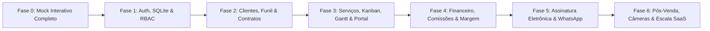

# PRD & Roadmap de Desenvolvimento — Hako Controle de Projeto (ERP & Portal do Cliente)

**Versão:** 1.0 (Outubro/2026)  
**Fonte:** Consolidado a partir de `SPEC-BACKEND.md`  
**Stack de Referência:** .NET 10 + Blazor Server + EF Core (SQLite → PostgreSQL) + ASP.NET Identity

---

## 1. Visão do Produto & Posicionamento

### 1.1 Propósito (MVP Comercial + Potencial SaaS)
O **Hako Controle de Projeto** nasce como um **MVP funcional de alto impacto visual e operacional para apresentação comercial à Hako Interiores**, cobrindo de ponta a ponta o ciclo de vida do negócio: captação do lead na Landing Page, funil de vendas com medições e orçamentos, emissão e assinatura de contratos, gestão de serviços (alvenaria e mobiliário) via Kanban e Gráfico de Gantt sincronizados, controle financeiro (contas a pagar/receber, comissões e margem por serviço) e transparência total ao consumidor final.

Desde a concepção, sua arquitetura e modelo de domínio (parametrizáveis via interface em `Config`) foram desenhados como um **produto SaaS replicável (white-label / multi-empresa)** para empresas do mesmo segmento: **design de interiores, marcenaria sob medida, reformas residenciais/comerciais e pequenas obras**.

### 1.2 Diferencial Central: Portal do Cliente (`/obra/{token}`)
A peça central de valor percebido pelo cliente final é o **Portal do Cliente sem login e sem dependência obrigatória de WhatsApp**. Assim que entra em contato ou inicia uma negociação, o cliente recebe um link único e seguro (`/obra/{token}`) pelo qual acompanha em tempo real:
1. **Fase Comercial:** status do orçamento e assinatura eletrônica do contrato na própria página.
2. **Fase de Execução:** progresso das etapas em visão Kanban simplificada, indicadores de saúde de prazo e galeria de fotos (*Antes, Andamento e Depois*).
3. **Fase de Entrega e Pós-Venda:** Termo de Entrega, comparativo *Antes e Depois* e abertura de chamados de garantia (90 dias).

---

## 2. Perfis de Acesso e Autorização (RBAC)

O controle de acesso opera em dois mundos distintos e complementares:

### 2.1 Acesso Interno (`/dashboard` — ASP.NET Identity + Claims)
Acesso autenticado via login/senha com proteção por Roles e Claims granulares no formato `perm="recurso.ação"` (`view` / `edit`), validadas tanto nos endpoints da API (retornando `401/403`) quanto na renderização de menus, widgets do Dashboard e abas dos cards de Clientes e Serviços:

| Role | Escopo de Claims (`perm`) | Visão Operacional |
|---|---|---|
| **Admin** | Todas as claims (`*`) | Acesso irrestrito a todas as seções, abas financeiras, configurações, templates e gestão de usuários. |
| **Comercial** | `clientes.*`, `funil.*`, `contratos.*`, `servicos.view` | Captação, funil de negociações, visitas/medições, orçamentos, emissão de contratos e acompanhamento de serviços. **Sem acesso a dados financeiros (`financeiro.*`).** |
| **Financeiro** | `financeiro.*`, `clientes.view`, `servicos.view` | Gestão de contas a pagar/receber, baixas, comissões de parceiros, orçamentos/margens por serviço e extrato financeiro do cliente. |
| **Serviços** | `servicos.*`, `clientes.view` | Gestão de execução em campo/oficina, etapas, Kanban, Cronograma (Gantt), alocação de equipe e upload de fotos/anexos. **Sem acesso a contratos (`contratos.*`) nem ao financeiro (`financeiro.*`).** |

### 2.2 Acesso Externo (`/obra/{token}` — Portal do Cliente)
- **Sem login, senha ou criação de conta:** acesso via URL opaca com token criptográfico de alta entropia (≥ 192 bits) vinculado ao lead/serviço.
- **Escopo estritamente Read-Only e minimizado (LGPD):** expõe apenas o progresso do serviço, fotos autorizadas (`visivelPortal = true`) e status contratual, ocultando documentos sensíveis (CPF/CNPJ) e detalhes financeiros internos.
- **Únicas interações permitidas:** assinar contrato (com validação pelo provedor de assinatura) e abrir chamado de garantia após a entrega. Token revogável/rotacionável pelo Admin.

---

## 3. Requisitos Funcionais por Módulo

### RF01 — Dashboard Adaptativo por Permissão
- **Tela única (`Dashboard.razor`)** cujos indicadores e gráficos são renderizados dinamicamente conforme as claims do usuário logado (endpoints filtrados na API sob `/api/dashboard/resumo` e `/api/dashboard/servicos-por-fase`).
- **Widgets por perfil:**
  - `funil.view`: Leads novos (vindos da LP) e orçamentos em aberto (`enviado`).
  - `clientes.view`: Total de clientes ativos e novos no mês.
  - `servicos.view`: Serviços em andamento, entregues no mês, distribuição de serviços por fase e alerta de etapas atrasadas/críticas (🔴).
  - `financeiro.view`: Faturamento do mês (% vs. mês anterior), contas a receber (30d), contas a pagar (30d + vencidas) e comissões pendentes.
- **Integração de Sessão com a LP:** cookie-marcador não-sensível (`hako_auth=1`) permite que a Landing Page exiba os atalhos `[Dashboard]` e `[Sair]` quando um usuário interno estiver autenticado.

### RF02 — Clientes (Gestão de Leads & Clientes)
- **Modelo Unificado (`Pessoas/Clientes`):** distingue `tipo: lead | cliente`. A promoção de `lead` para `cliente` é **automática, exclusiva e irreversível** quando a primeira negociação atinge o estágio **Ganho** (com contrato assinado).
- **Grid com Busca e Filtros Combináveis:**
  - Colunas: status (`Ativo | Inativo | Cancelado | Suspenso`) + badge `Lead | Cliente`, resumo de serviços (`🛠 em andamento`, `✓ entregue`, `✗ cancelado` + contador), badge de atraso (🔴), nome e celular com link de contato direto.
  - Busca rápida por nome, celular ou e-mail e filtros combináveis (tipo, status, origem, com serviço em andamento, com etapa atrasada).
- **Card do Cliente em 8 Abas (visibilidade controlada por Claim):**
  1. **Dados Pessoais** (`clientes.view`/`edit`): nome*, celular*, telefone secundário, e-mail, endereço cadastral completo (obrigatório para emissão de contrato), origem e observações.
  2. **Documentos/Contrato** (`clientes.view`/`edit`): CPF/CNPJ (obrigatório apenas para `cliente` ou ao emitir contrato — minimização LGPD), RG + órgão emissor, estado civil, profissão e nacionalidade.
  3. **Negociações** (`funil.view`/`edit`): **central de operação comercial e timeline auditável** do cliente. Concentra o agendamento e registro de **Visitas/Medições** (`data`, `ambientes/medidas` levantadas no local, `observações`) e o ciclo de **Orçamentos** (`versao`, `valor`, `condicoesPagamento`, `prazoExecucaoDias`, `escopoResumo`, upload de PDF e status `rascunho | enviado | aceito | recusado | substituido`). Registra automaticamente todo avanço do funil com data e autor.
  4. **Serviços** (`servicos.view`): lista os serviços vinculados ao cliente com saúde do prazo, fase atual e atalho para o card do serviço e Kanban.
  5. **Portal** (`clientes.view`/`edit`): exibe o link `/obra/{token}`, botão de regeneração/revogação do token, expiração e histórico de chamados de garantia.
  6. **Contratos** (`contratos.view`/`edit`): lista os contratos emitidos para o cliente, status de assinatura e serviço vinculado.
  7. **Financeiro** (`financeiro.view`/`edit`): recorte financeiro consolidado do cliente — soma dos contratos (`budget total`) e extrato unificado de todas as parcelas a receber e a pagar dos serviços daquele cliente. Invisível para Comercial e Serviços.
  8. **Mensagens / CRM** (`clientes.view`/`edit`): histórico unificado de comunicação via WhatsApp (`IMessagingProvider` conectado à Evolution API) e notas internas da equipe.
- **Suspensão em 2 Níveis e Regras de Status:**
  - Inativação manual (com motivo) ou automática via job diário (após 90 dias da última entrega sem serviços ativos).
  - **Suspensão em cascata:** um serviço pode ser suspenso individualmente (ex.: embargo, pendência técnica) ou no **nível do Cliente** (ex.: inadimplência, desacordo comercial), o que suspende automaticamente todos os seus serviços em andamento, pausando o Kanban e prorrogando a previsão de entrega em 1 dia por dia parado (`diasSuspensos`). Tudo auditado com motivo e data.

### RF03 — Funil de Negociações
- **Unidade do Card = `Negociacao` (por Serviço):** um mesmo lead ou cliente pode possuir múltiplos cards simultâneos no funil (ex.: um para Reforma de Cozinha e outro para Marcenaria).
- **Distinção Visual Imediata da Jornada:** todo card exibe claramente no topo se trata de aquisição (**"Lead → 1º contrato"**) ou recorrência (**"★ Cliente → novo contrato"**), além do `TipoServico` e alerta de inatividade (`⚠ parado há X dias`).
- **Controle Puramente Visual e Read-Only para Dados:** clicar no card não edita dados cadastrais ou valores. O board serve exclusivamente para leitura rápida do pipeline e movimentação de estágio.
- **Movimentação Estrita (Só Avança, Coluna Adjacente):**
  - Colunas: `Novo` (exclusiva para leads vindos do formulário da LP) → `Contato` (onde já nascem leads manuais e clientes recorrentes) → `Visita/Medição` → `Orçamento` → `Negociação` → `Ganho` | `Perdido`.
  - É proibido voltar de fase ou pular colunas.
  - **Affordance Visual no Drag & Drop:** ao iniciar o arraste de um card, **apenas a coluna imediatamente seguinte e a coluna Perdido** acendem como destinos válidos; as demais ficam bloqueadas/esmaecidas.
- **Gatilhos de Avanço Amarrados à Aba3 do Cliente:** cada transição entre colunas exige o preenchimento de um modal que grava o artefato na Aba3 do cliente (se cancelar o modal, o card não avança):
  - `Novo → Contato`: confirmação de realização do 1º contato.
  - `Contato → Visita/Medição`: agendamento obrigatório de `Visita`.
  - `Visita/Medição → Orçamento`: exige `Visita` com status `realizada` (e medições registradas) + registro de `Orcamento` com status `enviado`.
  - `Orçamento → Negociação`: exige marcar o `Orcamento` como `aceito` (aprovado pelo cliente) + emissão/envio do `Contrato` (status `enviado`/`aguardando`).
  - `Negociação → Ganho`: exige confirmação de contrato `assinado` → promove lead a `cliente` e **cria automaticamente o Serviço** com etapas-padrão e valores do orçamento aprovado.
- **Perda e Reabertura Encadeada:** mover para `Perdido` exige `motivoPerda` estruturado (`desacordo_comercial` ou `fechou_concorrencia` com submotivo `valor | prazo | ambos | outro`, ou `sem_resposta`). Permite a ação **"Cancelar e abrir nova negociação"**, criando um novo card vinculado ao anterior (mantendo o histórico e versionamento de orçamentos na Aba3).

### RF04 — Contratos e Assinatura Eletrônica
- **Estrutura em 2 Abas (`contratos.view`/`edit`):**
  1. **Emitidos:** visão geral de todos os contratos com busca e filtros por status (`rascunho | enviado | aguardando | assinado | cancelado`) e tipo de serviço. Segue o princípio de **uma fonte, três recortes** (visível na seção Contratos, na Aba6 do Cliente e na Aba Contrato do Serviço).
  2. **Modelos (`ContratoTemplates`):** catálogo de templates por `TipoServico` ou categoria (`alvenaria | mobiliario`), com **versionamento automático** (edições geram nova versão sem alterar o snapshot `textoRenderizado`/`pdfGerado` de contratos já emitidos).
- **Editor Simples com Variáveis Dinâmicas (`{{campo}}`):**
  - Barra de inserção rápida de variáveis substituídas automaticamente na emissão a partir de 3 fontes obrigatórias:
    - **Cliente (Aba1 + Aba2):** `{{cliente.nome}}`, `{{cliente.cpf_cnpj}}`, `{{cliente.rg}}`, `{{cliente.estado_civil}}`, `{{cliente.profissao}}`, `{{cliente.nacionalidade}}`, `{{cliente.endereco_completo}}`, `{{cliente.celular}}`, `{{cliente.email}}`.
    - **Medições da Visita (Aba3):** `{{medicao.data}}`, `{{medicao.ambientes_medidas}}`, `{{medicao.observacoes}}`.
    - **Orçamento Aprovado `status=aceito` (Aba3):** `{{orcamento.versao}}`, `{{orcamento.valor_total}}`, `{{orcamento.valor_extenso}}`, `{{orcamento.condicoes_pagamento}}`, `{{orcamento.prazo_execucao_dias}}`, `{{orcamento.escopo_resumo}}`, além de `{{servico.tipo}}`, `{{servico.endereco_execucao}}`, `{{contrato.data_emissao}}` e `{{contrato.cidade_foro}}`.
  - Não é permitido digitar valores avulsos no contrato fora do orçamento aprovado. Se faltarem dados documentais do cliente na Aba1/Aba2, o modal de emissão solicita o preenchimento na hora.
- **Assinatura Pluggable (`ISignatureProvider`):** arquitetura desacoplada com suporte a `ManualProvider` (upload do PDF assinado / aceite no portal — ativo no MVP inicial), `ZapSignProvider` (SaaS BR) e `DocuSealProvider` (self-hosted).

### RF05 — Serviços (Execução de Alvenaria e Mobiliário)
- **Criação e Imutabilidade de Identidade:** nasce automaticamente no **Ganho** do funil (ou via botão `[+ Novo serviço]`) copiando a árvore de etapas do `TemplateEtapa` do respectivo `TipoServico`. Uma vez gravado, **Cliente e Tipo de Serviço são imutáveis** (somente leitura em todas as abas).
- **Grid de Serviços:**
  - Colunas: saúde do prazo (`⚪🟢🟡🔴🔵`), tipo de serviço, cliente, **Fase Atual** (etapa ativa em `Em andamento` ou `Iniciada`), `%` de execução e previsão de entrega (`dtEntrega`).
  - Busca por nome do cliente e filtros combináveis (status, tipo, categoria `alvenaria | mobiliario`, saúde do prazo e local de execução).
  - **Destaque de 100% no Grid (Fluxo de Entrega Manual):** quando todas as etapas atingem `Entregue` (100%) no Kanban, o serviço permanece com `status = andamento`, mas **a linha no grid recebe cor de fundo diferenciada** indicando que aguarda vistoria/entrega final. Se houver pendências de vistoria, novas tarefas podem ser criadas (voltando o serviço ao fluxo normal); se aprovado, o usuário aciona **Confirmar Finalização Definitiva** (registrando `dtEntregaEfetiva`, fotos finais e termo), mudando o status para `encerrada` e virando o Portal do Cliente para o estado **Entregue**.
- **Card do Serviço em 6 Abas (autorizadas por Claim):**
  1. **Dados** (`servicos.view`/`edit`): cliente e tipo (leitura), status, datas (`dtInicio`, `dtInicioEfetivo` preenchida automaticamente ao iniciar a 1ª etapa no Kanban, e `dtEntrega`), local de execução (`no_local` com snapshot do endereço do cliente ou endereço informado; ou `oficina` com endereço de instalação posterior), `% Calculado` pelo Kanban e campo de **Ajuste Manual de `%`** (armazena o `delta`; **exige justificativa obrigatória sempre que o novo `%` for menor que o exibido**, gravando log em `AjustePercentual`).
  2. **Etapas** (`servicos.view`/`edit`): gestão da árvore de tarefas pai, sub-tarefas (`parentId`), durações e dependências (`predecessoraId`), respeitando a trava da janela do serviço.
  3. **Equipe** (`servicos.view`/`edit`): vincula Funcionários, Colaboradores e Parceiros ativos ao serviço (`ServicoEquipe`). Para Parceiros, grava o **snapshot de `comissaoPct`** vigente no momento do vínculo (protegendo serviços fechados contra alterações futuras de cadastro) e exibe apenas o `%` (valores em R$ ficam restritos ao Financeiro). Somente membros alocados nesta aba aparecem como responsáveis nas etapas.
  4. **Anexos** (`servicos.view`/`edit`): upload de documentos técnicos internos (plantas, detalhamentos) e fotos classificadas por etapa e momento (`antes | andamento | depois`), com toggle `visivelPortal` para publicação imediata em `/obra/{token}`.
  5. **Contrato** (`contratos.view`/`edit`): visualiza o contrato assinado que deu origem ao serviço, aditivos e Termo de Entrega (invisível para a role `Serviços`).
  6. **Financeiro** (`financeiro.view`/`edit`): extrato exclusivo do serviço (receber + pagar), budget (`valorContrato`) e cálculo de margem (invisível para `Comercial` e `Serviços`).

### RF06 — Kanban de Serviço (Operação de Equipe)
- **Seletor de Serviços em Andamento:** dropdown no topo lista todos os serviços com `status = andamento`.
- **Quadro em 5 Colunas com Percentuais Fixos:**
  - `A iniciar` (**0%**) → `Iniciada` (**10%**, grava `dtInicioReal` na etapa e `dtInicioEfetivo` no serviço) → `Em andamento` (**50%**) → `Finalizada` (**90%**, grava `dtRealizada`) → `Entregue` (**100%**).
- **Precedência (`predecessoraId`):** uma tarefa dependente permanece bloqueada em `A iniciar` até que sua predecessora atinja `Finalizada` (ou `Entregue`, se a predecessora for uma tarefa pai com sub-tarefas).
- **Hierarquia Tarefa Pai e Sub-tarefas (`parentId`):**
  - Quando uma tarefa possui sub-tarefas, a **Tarefa Pai fica estacionada na coluna `Iniciada`** e os cards de suas **Sub-tarefas são exibidos logo abaixo dela**, avançando pelas colunas `Em andamento` (50%) e `Finalizada` (90%).
  - Enquanto estacionada em `Iniciada`, o `%` da Tarefa Pai evolui automaticamente pela média ponderada da duração de suas sub-tarefas (de 10% a 90%).
  - A Tarefa Pai permanece bloqueada em `Iniciada` enquanto houver qualquer sub-tarefa não finalizada.
  - Assim que **todas as sub-tarefas chegam a `Finalizada`**, a Tarefa Pai é liberada para avançar para **`Entregue` (100%)**.
  - Na coluna **`Entregue`**, os cards das sub-tarefas são **recolhidos do quadro** para manter a visualização limpa, sendo **exibidos ao passar o mouse (`:hover`) ou tocar (mobile)** sobre o card da Tarefa Pai.
- **Cores de Saúde do Prazo (computadas dinamicamente):**
  - ⚪ **Branca:** `A iniciar` antes da `dtInicioPrevista`.
  - 🟢 **Verde:** em execução dentro do prazo normal (`% decorrido < alertaPct`, padrão 70%).
  - 🟡 **Amarela:** atenção (`% decorrido ≥ 70%` ou não iniciada na data prevista).
  - 🔴 **Vermelha:** atrasada (`hoje > dtPrevista` e não concluída).
  - 🔵 **Azul:** concluída (`Finalizada` ou `Entregue`).

### RF07 — Cronograma / Gráfico de Gantt
- **Sincronia Bidirecional em Tempo Real com o Kanban:** compartilha a mesma base (`ServicoEtapas`). Mover um card no Kanban preenche imediatamente a barra de progresso interno (`0% / 10% / 50% / 90% / 100%`) e atualiza as datas e cores de saúde no Gantt; ajustar datas no Gantt recalcula imediatamente a saúde do prazo no Kanban.
- **Visão Split (Árvore + Timeline):**
  - Seletor no topo permite visualizar **"Todos os serviços em andamento (consolidado)"** ou um serviço específico, com controles de zoom (`Dia · Semana · Mês`) e botão `[Hoje]`.
  - À esquerda: árvore hierárquica expansível (**Serviço → Tarefas Pai → Sub-tarefas**).
  - À direita: barra-resumo do serviço (`dtInicio` → `dtEntrega` com `%` global), barras das tarefas/sub-tarefas coloridas pela saúde do prazo (`⚪🟢🟡🔴🔵`) com preenchimento interno do `%` de execução e setas de dependência (`predecessoraId`).
- **Travas de Janela de Prazo:** o sistema impede que a soma das durações das tarefas de topo ultrapasse o prazo do serviço, que sub-tarefas extrapolem a janela da tarefa pai, que etapas saiam do intervalo `dtInicio..dtEntrega` ou que tarefas dependentes iniciem antes de suas predecessoras.

### RF08 — Financeiro (Receber, Pagar, Comissões e Margem)
- **Uma Fonte, Três Recortes (Valores em Centavos):** todos os registros de `ParcelasReceber` e `ParcelasPagar` são vinculados a um `servicoId` e exibidos sem duplicação na **Seção Financeiro** (geral), na **Aba Financeiro do Serviço** (escopo do serviço) e na **Aba7 Financeiro do Cliente** (todos os serviços da pessoa).
- **Grid Único Unificado (Pagar ▲ + Receber ▼):**
  - Indicadores superiores: Total a Receber, Total a Pagar, Saldo Previsto, Vencidos (🔴) e Comissões Pendentes.
  - Filtros combináveis por direção (`receber | pagar`), status (`pendente | vencido | pago | cancelado`), natureza (`comissão | material | mão-de-obra`), cliente/serviço e período de vencimento.
- **Automação de Lançamentos e Margem:**
  - **Contas a Receber:** geradas/sugeridas automaticamente no **Ganho** do funil a partir do `valorContrato` e das `condicoesPagamento` do Orçamento aprovado (`aceito`).
  - **Comissões de Parceiros:** geradas automaticamente em `ParcelasPagar` quando um Parceiro é vinculado à equipe do serviço (ou originou a indicação), calculando `valorContrato × comissaoPct (snapshot)`.
  - **Custos Diretos (`material | mao-de-obra`):** lançados vinculados ao serviço e ao fornecedor/colaborador.
  - **Margem por Serviço:** apuração automática em tempo real de `Margem Prevista = valorContrato − Σ(Pagar Previsto)` e `Margem Realizada = Σ(Receber Pago) − Σ(Pagar Pago)`.
- **Governança:** baixas registram `pagoEm` e comprovante opcional; cancelamentos exigem justificativa obrigatória (nunca há `DELETE`).

### RF09 — Equipe Unificada
- **Cadastro Único em 3 Perfis:** reúne **Funcionários** (equipe interna), **Colaboradores** (prestadores de campo/oficina: marceneiros, pedreiros, pintores, montadores) e **Parceiros** (arquitetos, engenheiros, designers, indicadores) em um único grid com busca e filtros por perfil, status e alocação ativa.
- **Comissão Exclusiva para Parceiros:** o campo `comissaoPct` é habilitado e obrigatório apenas quando `perfil = parceiro` (exibindo `—` no grid para os demais). Quando alocado em um serviço, esse percentual é copiado como snapshot para `ServicoEquipe`.
- **Histórico no Card:** exibe todos os serviços em que o profissional atuou e, para usuários com `financeiro.view`, seu extrato de pagamentos e comissões.

### RF10 — Configurações (`Config` — Restrito ao Admin)
Projetado para tornar o sistema 100% parametrizável e pronto para escala SaaS em 4 abas:
1. **Tipos de Serviço e Etapas-Padrão (`TiposServico` + `TemplateEtapa`):** cadastro de tipos por categoria (`alvenaria | mobiliario`) e definição da árvore padrão de tarefas pai, sub-tarefas, durações em dias e dependências que serão copiadas automaticamente ao criar cada serviço.
2. **Empresa, Oficina e Parâmetros (`ConfigSistema`):** dados institucionais para contratos/PDFs, endereço único da oficina (`oficina.endereco`) e parâmetros operacionais (`kanban.alertaPct = 70`, `garantia.prazoDias = 90`, `funil.diasAlertaParado = 7`).
3. **Usuários e Permissões (`Identity`):** cadastro/inativação de usuários internos, atribuição de Roles (`Admin`, `Comercial`, `Financeiro`, `Serviços`) e consulta à matriz de claims.
4. **Integrações e Portal/LP:** seleção e credenciais do `ISignatureProvider` (`Manual | ZapSign | DocuSeal`), configuração da instância Evolution API (`IWhatsAppNotifier` com eSIM dedicado) e **Mini-CMS da Landing Page** (`/api/public/stats` e `/api/public/conteudo`).

### RF11 — Portal do Cliente (`/obra/{token}`)
- **Experiência Transparente de Ponta a Ponta:**
  - **Durante a Negociação:** apresenta o resumo da proposta comercial e o contrato pronto para assinatura eletrônica (ou download do PDF assinado).
  - **Durante a Execução do Serviço:** exibe o cabeçalho do serviço, percentual geral de avanço, etapas em visão Kanban read-only com cores de saúde do prazo e galeria de fotos das etapas marcadas com `visivelPortal = true` (organizadas em *Antes, Andamento e Depois*).
  - **Após a Entrega (`status = encerrada`):** exibe o comparativo visual *Antes e Depois*, o Termo de Entrega assinado e habilita o botão de **Abertura de Chamado de Garantia** durante o período parametrizado (padrão: 90 dias corridos após `dtEntregaEfetiva`).

---

## 4. Requisitos Não-Funcionais (RNF)

### RNF01 — Design System Mobile-First (Uso em Campo / Obra)
- Toda a interface do `/dashboard` e do `/obra/{token}` é projetada **Mobile-First**, garantindo ergonomia total em **3 breakpoints (Mobile · Tablet · Desktop)** para uso direto no local do serviço:
  - Sidebar auto-oculta por `:hover` no desktop (sem dependência de JS) e menu *drawer* no mobile.
  - Grids convertem-se em listas de cards responsivos em telas pequenas; modais abrem em tela cheia no mobile; quadros de Funil e Kanban operam com scroll horizontal fluido por coluna e suporte a toque nos tooltips de sub-tarefas.
  - Suporte nativo a **Tema Claro / Escuro** persistido via CSS variables.

### RNF02 — Integridade Histórica e Auditoria (Zero Physical Delete)
- **Proibição absoluta de `DELETE` físico** em entidades de negócio (clientes, negociações, orçamentos, contratos, serviços, etapas, anexos, lançamentos financeiros e membros da equipe).
- Toda desistência, inativação, suspensão, redução manual de percentual de serviço ou cancelamento de parcela exige **motivo/justificativa obrigatória**, registrando data/hora e `usuarioId`.
- **Snapshots de Imutabilidade:** comissões de parceiros (`ServicoEquipe.comissaoPct`), endereços de execução/instalação e textos/PDFs de contratos emitidos (`textoRenderizado`) são gravados por snapshot no momento da contratação, impedindo que edições futuras de cadastro corrompam o histórico contratado.

### RNF03 — Conformidade com a LGPD (Privacy by Design)
- **Minimização de Dados:** leads captados na LP ou cadastrados manualmente armazenam apenas nome e contato; documentos sensíveis (CPF/CNPJ, RG) só são exigidos na emissão de contrato ou promoção para `cliente`.
- **Exposição Controlada no Portal:** `/obra/{token}` omite dados documentais e valores financeiros discriminados.
- **Direitos do Titular:** página pública `/privacidade.html` integrada à LP e registro de consentimento/auditoria no backend.

### RNF04 — Segurança em Camadas e Infraestrutura
- **Defesa em Profundidade:** Cloudflare (WAF, Proxy, TLS, Rate Limiting) → Nginx Reverse Proxy → Container `.NET 10` (`hako-admin` na rede `www_projetos-net`).
- **Proteção de Rotas e Endpoints:** `/dashboard` protegido por ASP.NET Identity, cookies seguros (`HttpOnly`, `Secure`, `SameSite`), políticas de autorização por claim em cada endpoint da API, validação server-side, rate limiting por IP em `/api/public/leads` (com *honeypot* anti-spam) e em `/obra/{token}`.

---

## 5. Plano de Desenvolvimento e Roadmap por Fases

O desenvolvimento está estruturado em **7 fases incrementais (Fase 0 a Fase 6)**, priorizando a validação comercial imediata com a Hako Interiores e a entrega contínua de valor:

| Fase | Nome da Entrega | Escopo Detalhado | Critério de Pronto (DoD) |
|---|---|---|---|
| **Fase 0** | **Mock Interativo Completo (Validação Comercial)** | Scaffold `.NET 10 + Blazor Server`, design system mobile-first (claro/escuro), sidebar auto-oculta, seletor `"Visualizar como"` (simulando as 4 roles) e navegação funcional com dados realistas em todas as seções: Dashboard, Clientes (8 abas), Funil (affordance e modais), Serviços (6 abas + destaque 100%), Kanban (hierarquia Pai/Filhas), Cronograma (Gantt sincronizado), Financeiro, Contratos, Equipe, Config e Portal `/obra/{token}`. | Apresentação comercial navegável aprovada pela Hako Interiores em desktop e mobile. |
| **Fase 1** | **Fundação: Auth, SQLite & RBAC Real** | Configuração do EF Core + SQLite (em volume Docker persistente), migrations iniciais, ASP.NET Identity com login/logout, seed das 4 Roles (`Admin`, `Comercial`, `Financeiro`, `Serviços`) e policies por claim (`recurso.view`/`edit`), integração do cookie-marcador `hako_auth=1` com a LP e módulo `Config` (Usuários, Parâmetros e Tipos de Serviço + Templates de Etapas). | Login real funcionando sob `/dashboard`, permissões bloqueando rotas/abas/APIs não autorizadas e catálogo base configurável. |
| **Fase 2** | **Comercial: Clientes, Funil & Contratos** | CRUD completo de Clientes (8 abas com restrição por claim), endpoint público `POST /api/public/leads` integrado ao formulário da LP, Funil de Negociações com travas de coluna adjacente e modais de transição (Visitas/Medições + Orçamentos na Aba3), geração de Contratos a partir de Templates (`{{variáveis}}` de Cliente + Medições + Orçamento `aceito`), geração de PDF + `ManualProvider` e Portal `/obra/{token}` exibindo a fase de negociação/contrato. | Ciclo completo *Lead na LP → Visita/Medição → Orçamento Aceito → Contrato Assinado → Promoção para Cliente* operando em banco de dados. |
| **Fase 3** | **Operação: Serviços, Kanban, Gantt & Portal** | Criação automática de Serviço no Ganho do funil (copiando `TemplateEtapa`), CRUD de Equipe unificada (com snapshot de comissão), Card de Serviço em 6 abas (com ajuste manual de `%` auditado e suspensão em 2 níveis), Kanban interativo (5 colunas, precedência, Tarefa Pai estacionada em `Iniciada` com Sub-tarefas e recolhimento em `Entregue` com `:hover`), Gráfico de Gantt sincronizado em tempo real, destaque de 100% no grid para entrega manual, upload de fotos (`antes/andamento/depois`) e atualização do Portal `/obra/{token}` com o acompanhamento da obra. | Gestão de execução completa em campo/oficina, Kanban e Gantt sincronizados e cliente acompanhando etapas e fotos pelo link `/obra/{token}`. |
| **Fase 4** | **Financeiro, Comissões & Margem por Serviço** | Lançamentos em centavos (`ParcelasReceber` e `ParcelasPagar`) em fonte única e três recortes (Geral, Serviço e Cliente), geração automática de parcelas a receber no Ganho (via orçamento aprovado) e de comissões a pagar (via snapshot de parceiros na equipe), registro de custos de material/mão-de-obra, fluxo de baixas e cancelamentos auditados, apuração de Margem Prevista vs. Realizada por serviço e ativação dos widgets financeiros do Dashboard. | Controle de caixa, comissões e rentabilidade real por serviço operando para `Admin` e `Financeiro`. |
| **Fase 5** | **Integrações: Assinatura Eletrônica & WhatsApp** | Implementação do adaptador definitivo de assinatura eletrônica (`ZapSignProvider` ou `DocuSealProvider`) com webhook de confirmação automática de assinatura (destravando o Ganho), integração do `IWhatsAppNotifier` / `IMessagingProvider` com a instância Evolution API (via eSIM dedicado Hako) para alertas comerciais, notificações auxiliares ao cliente e Aba8 (Mensagens CRM), além do Mini-CMS da LP (`/api/public/stats` e `/api/public/conteudo`). | Assinatura eletrônica automatizada no Portal e comunicação WhatsApp centralizada na ficha do cliente. |
| **Fase 6** | **Pós-Venda, Câmeras & Consolidação SaaS** | Fluxo completo de Chamados de Garantia (90 dias pós-entrega) pelo Portal `/obra/{token}`, geração de QR Code por serviço para check-in de etapa com foto obrigatória pelo colaborador em campo, integração opcional de snapshots agendados de câmeras IP na obra, comparativo *Antes e Depois* automatizado e preparação multi-tenant / migração opcional de provider EF Core para PostgreSQL para comercialização SaaS. | Produto maduro em operação plena na Hako Interiores e empacotado para replicação comercial em novas empresas do setor. |
